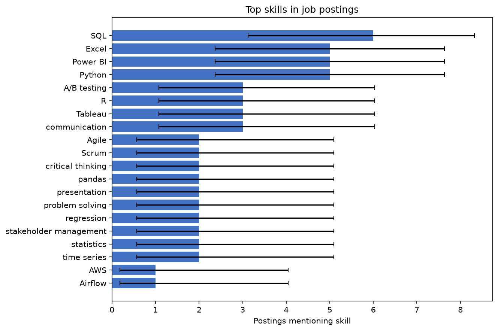

# JobLens Report

## Overview
10 postings analyzed.

| Country | Postings |
| --- | --- |
| UK | 4 |
| Australia | 3 |
| India | 3 |

| Role family | Postings |
| --- | --- |
| data analyst | 4 |
| business analyst | 3 |
| research analyst | 3 |

## Top skills
| Skill | Count | Share | 95% Wilson interval |
| --- | --- | --- | --- |
| SQL | 6 | 60.0% | 31.3%–83.2% |
| Excel | 5 | 50.0% | 23.7%–76.3% |
| Power BI | 5 | 50.0% | 23.7%–76.3% |
| Python | 5 | 50.0% | 23.7%–76.3% |
| A/B testing | 3 | 30.0% | 10.8%–60.3% |
| R | 3 | 30.0% | 10.8%–60.3% |
| Tableau | 3 | 30.0% | 10.8%–60.3% |
| communication | 3 | 30.0% | 10.8%–60.3% |
| Agile | 2 | 20.0% | 5.7%–51.0% |
| Scrum | 2 | 20.0% | 5.7%–51.0% |
| critical thinking | 2 | 20.0% | 5.7%–51.0% |
| pandas | 2 | 20.0% | 5.7%–51.0% |
| presentation | 2 | 20.0% | 5.7%–51.0% |
| problem solving | 2 | 20.0% | 5.7%–51.0% |
| regression | 2 | 20.0% | 5.7%–51.0% |
| stakeholder management | 2 | 20.0% | 5.7%–51.0% |
| statistics | 2 | 20.0% | 5.7%–51.0% |
| time series | 2 | 20.0% | 5.7%–51.0% |
| AWS | 1 | 10.0% | 1.8%–40.4% |
| Airflow | 1 | 10.0% | 1.8%–40.4% |
| Azure | 1 | 10.0% | 1.8%–40.4% |
| BigQuery | 1 | 10.0% | 1.8%–40.4% |
| GCP | 1 | 10.0% | 1.8%–40.4% |
| Git | 1 | 10.0% | 1.8%–40.4% |
| Looker | 1 | 10.0% | 1.8%–40.4% |
| NumPy | 1 | 10.0% | 1.8%–40.4% |
| PostgreSQL | 1 | 10.0% | 1.8%–40.4% |
| SAS | 1 | 10.0% | 1.8%–40.4% |
| SQL Server | 1 | 10.0% | 1.8%–40.4% |
| Snowflake | 1 | 10.0% | 1.8%–40.4% |
| business process modeling | 1 | 10.0% | 1.8%–40.4% |
| causal inference | 1 | 10.0% | 1.8%–40.4% |
| dbt | 1 | 10.0% | 1.8%–40.4% |
| forecasting | 1 | 10.0% | 1.8%–40.4% |
| probability | 1 | 10.0% | 1.8%–40.4% |
| project management | 1 | 10.0% | 1.8%–40.4% |
| requirements gathering | 1 | 10.0% | 1.8%–40.4% |
| scikit-learn | 1 | 10.0% | 1.8%–40.4% |



## Group comparisons
### By country
> **Warning:** one or more groups contain fewer than 5 postings.
| Skill | Group | Odds ratio | p-value | BH-adjusted p | Method |
| --- | --- | --- | --- | --- | --- |
| statistics | Australia | 25.00 | 0.06667 | 1 | Fisher exact |
| Agile | UK | 0.20 | 0.4667 | 1 | Fisher exact |
| presentation | UK | 0.20 | 0.4667 | 1 | Fisher exact |
| regression | UK | 0.20 | 0.4667 | 1 | Fisher exact |
| stakeholder management | UK | 0.20 | 0.4667 | 1 | Fisher exact |
| statistics | UK | 0.20 | 0.4667 | 1 | Fisher exact |
| A/B testing | Australia | 1.25 | 1 | 1 | Fisher exact |
| A/B testing | India | 1.25 | 1 | 1 | Fisher exact |
| A/B testing | UK | 0.67 | 1 | 1 | Fisher exact |
| Agile | Australia | 3.00 | 1 | 1 | Fisher exact |
| Agile | India | 3.00 | 1 | 1 | Fisher exact |
| Excel | Australia | 2.67 | 1 | 1 | Fisher exact |
| Excel | India | 0.38 | 1 | 1 | Fisher exact |
| Excel | UK | 1.00 | 1 | 1 | Fisher exact |
| Power BI | Australia | 2.67 | 1 | 1 | Fisher exact |
| Power BI | India | 0.38 | 1 | 1 | Fisher exact |
| Power BI | UK | 1.00 | 1 | 1 | Fisher exact |
| Python | Australia | 2.67 | 1 | 1 | Fisher exact |
| Python | India | 0.38 | 1 | 1 | Fisher exact |
| Python | UK | 1.00 | 1 | 1 | Fisher exact |
| R | Australia | 1.25 | 1 | 1 | Fisher exact |
| R | India | 1.25 | 1 | 1 | Fisher exact |
| R | UK | 0.67 | 1 | 1 | Fisher exact |
| SQL | Australia | 1.50 | 1 | 1 | Fisher exact |
| SQL | India | 1.50 | 1 | 1 | Fisher exact |
| SQL | UK | 0.50 | 1 | 1 | Fisher exact |
| Scrum | Australia | 3.00 | 1 | 1 | Fisher exact |
| Scrum | India | 0.31 | 1 | 1 | Fisher exact |
| Scrum | UK | 1.67 | 1 | 1 | Fisher exact |
| Tableau | Australia | 1.25 | 1 | 1 | Fisher exact |
| Tableau | India | 1.25 | 1 | 1 | Fisher exact |
| Tableau | UK | 0.67 | 1 | 1 | Fisher exact |
| communication | Australia | 1.25 | 1 | 1 | Fisher exact |
| communication | India | 1.25 | 1 | 1 | Fisher exact |
| communication | UK | 0.67 | 1 | 1 | Fisher exact |
| critical thinking | Australia | 3.00 | 1 | 1 | Fisher exact |
| critical thinking | India | 0.31 | 1 | 1 | Fisher exact |
| critical thinking | UK | 1.67 | 1 | 1 | Fisher exact |
| pandas | Australia | 3.00 | 1 | 1 | Fisher exact |
| pandas | India | 0.31 | 1 | 1 | Fisher exact |
| pandas | UK | 1.67 | 1 | 1 | Fisher exact |
| presentation | Australia | 3.00 | 1 | 1 | Fisher exact |
| presentation | India | 3.00 | 1 | 1 | Fisher exact |
| problem solving | Australia | 0.31 | 1 | 1 | Fisher exact |
| problem solving | India | 3.00 | 1 | 1 | Fisher exact |
| problem solving | UK | 1.67 | 1 | 1 | Fisher exact |
| regression | Australia | 3.00 | 1 | 1 | Fisher exact |
| regression | India | 3.00 | 1 | 1 | Fisher exact |
| stakeholder management | Australia | 3.00 | 1 | 1 | Fisher exact |
| stakeholder management | India | 3.00 | 1 | 1 | Fisher exact |
| statistics | India | 0.31 | 1 | 1 | Fisher exact |
| time series | Australia | 0.31 | 1 | 1 | Fisher exact |
| time series | India | 3.00 | 1 | 1 | Fisher exact |
| time series | UK | 1.67 | 1 | 1 | Fisher exact |

### By role_family
> **Warning:** one or more groups contain fewer than 5 postings.
| Skill | Group | Odds ratio | p-value | BH-adjusted p | Method |
| --- | --- | --- | --- | --- | --- |
| SQL | research analyst | 0.03 | 0.03333 | 0.5143 | Fisher exact |
| Tableau | data analyst | 30.33 | 0.03333 | 0.5143 | Fisher exact |
| Agile | business analyst | 25.00 | 0.06667 | 0.5143 | Fisher exact |
| Scrum | business analyst | 25.00 | 0.06667 | 0.5143 | Fisher exact |
| pandas | research analyst | 25.00 | 0.06667 | 0.5143 | Fisher exact |
| regression | research analyst | 25.00 | 0.06667 | 0.5143 | Fisher exact |
| time series | research analyst | 25.00 | 0.06667 | 0.5143 | Fisher exact |
| SQL | data analyst | 16.20 | 0.07619 | 0.5143 | Fisher exact |
| stakeholder management | data analyst | 13.00 | 0.1333 | 0.6923 | Fisher exact |
| Excel | research analyst | 0.06 | 0.1667 | 0.6923 | Fisher exact |
| Power BI | business analyst | 15.40 | 0.1667 | 0.6923 | Fisher exact |
| Power BI | research analyst | 0.06 | 0.1667 | 0.6923 | Fisher exact |
| Python | business analyst | 0.06 | 0.1667 | 0.6923 | Fisher exact |
| R | research analyst | 12.00 | 0.1833 | 0.7071 | Fisher exact |
| Agile | data analyst | 0.20 | 0.4667 | 1 | Fisher exact |
| Scrum | data analyst | 0.20 | 0.4667 | 1 | Fisher exact |
| pandas | data analyst | 0.20 | 0.4667 | 1 | Fisher exact |
| regression | data analyst | 0.20 | 0.4667 | 1 | Fisher exact |
| time series | data analyst | 0.20 | 0.4667 | 1 | Fisher exact |
| A/B testing | business analyst | 0.18 | 0.475 | 1 | Fisher exact |
| R | business analyst | 0.18 | 0.475 | 1 | Fisher exact |
| Tableau | business analyst | 0.18 | 0.475 | 1 | Fisher exact |
| Tableau | research analyst | 0.18 | 0.475 | 1 | Fisher exact |
| A/B testing | data analyst | 5.00 | 0.5 | 1 | Fisher exact |
| Excel | data analyst | 6.00 | 0.5238 | 1 | Fisher exact |
| Python | data analyst | 6.00 | 0.5238 | 1 | Fisher exact |
| A/B testing | research analyst | 1.25 | 1 | 1 | Fisher exact |
| Agile | research analyst | 0.31 | 1 | 1 | Fisher exact |
| Excel | business analyst | 2.67 | 1 | 1 | Fisher exact |
| Power BI | data analyst | 1.00 | 1 | 1 | Fisher exact |
| Python | research analyst | 2.67 | 1 | 1 | Fisher exact |
| R | data analyst | 0.67 | 1 | 1 | Fisher exact |
| SQL | business analyst | 1.50 | 1 | 1 | Fisher exact |
| Scrum | research analyst | 0.31 | 1 | 1 | Fisher exact |
| communication | business analyst | 1.25 | 1 | 1 | Fisher exact |
| communication | data analyst | 0.67 | 1 | 1 | Fisher exact |
| communication | research analyst | 1.25 | 1 | 1 | Fisher exact |
| critical thinking | business analyst | 0.31 | 1 | 1 | Fisher exact |
| critical thinking | data analyst | 1.67 | 1 | 1 | Fisher exact |
| critical thinking | research analyst | 3.00 | 1 | 1 | Fisher exact |
| pandas | business analyst | 0.31 | 1 | 1 | Fisher exact |
| presentation | business analyst | 3.00 | 1 | 1 | Fisher exact |
| presentation | data analyst | 1.67 | 1 | 1 | Fisher exact |
| presentation | research analyst | 0.31 | 1 | 1 | Fisher exact |
| problem solving | business analyst | 3.00 | 1 | 1 | Fisher exact |
| problem solving | data analyst | 1.67 | 1 | 1 | Fisher exact |
| problem solving | research analyst | 0.31 | 1 | 1 | Fisher exact |
| regression | business analyst | 0.31 | 1 | 1 | Fisher exact |
| stakeholder management | business analyst | 0.31 | 1 | 1 | Fisher exact |
| stakeholder management | research analyst | 0.31 | 1 | 1 | Fisher exact |
| statistics | business analyst | 0.31 | 1 | 1 | Fisher exact |
| statistics | data analyst | 1.67 | 1 | 1 | Fisher exact |
| statistics | research analyst | 3.00 | 1 | 1 | Fisher exact |
| time series | business analyst | 0.31 | 1 | 1 | Fisher exact |

## Your match
Mean coverage: **50.0%**

### Top gaps
| Skill | Prevalence | 95% Wilson interval |
| --- | --- | --- |
| A/B testing | 30.0% | 10.8%–60.3% |
| Agile | 20.0% | 5.7%–51.0% |
| Scrum | 20.0% | 5.7%–51.0% |
| critical thinking | 20.0% | 5.7%–51.0% |
| presentation | 20.0% | 5.7%–51.0% |
| problem solving | 20.0% | 5.7%–51.0% |
| regression | 20.0% | 5.7%–51.0% |
| time series | 20.0% | 5.7%–51.0% |
| Airflow | 10.0% | 1.8%–40.4% |
| Azure | 10.0% | 1.8%–40.4% |

### Top strengths
| Skill | Prevalence |
| --- | --- |
| SQL | 60.0% |
| Excel | 50.0% |
| Power BI | 50.0% |
| Python | 50.0% |
| R | 30.0% |
| Tableau | 30.0% |
| communication | 30.0% |
| pandas | 20.0% |
| stakeholder management | 20.0% |
| statistics | 20.0% |

## Limitations
- Keyword matching cannot tell required skills from nice-to-have skills.
- Results depend on how postings were collected.
- Small n gives wide intervals.
- Many tests were run, hence Benjamini-Hochberg correction.

## Reproduce
```bash
uv run joblens report samples/jobs --skills samples/my_skills.example.txt --out samples/report_demo.md
```
